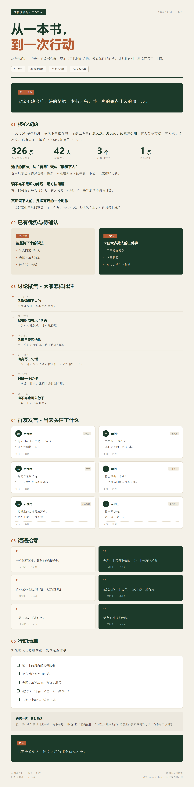

# 微信群聊 → 日报长图

把微信群某一天的消息，变成一张研究报告式长图。



## 一行命令

复制到终端，或者直接粘给你的 Agent：

```bash
npx --yes git+https://github.com/liangshisan-mu/wechat-daily-report.git
```

带群名和日期，一步出图：

```bash
npx --yes git+https://github.com/liangshisan-mu/wechat-daily-report.git --group "群名" --date 2026-10-31
```

这一行会依次完成：下载项目 → 安装依赖 → 连接微信 → 生成长图。

> 前提：Windows 10/11、微信 4.x 已登录、Python 3.10+。首次约 3-5 分钟，之后可重复使用。

## 它做什么

| 输入 | 输出 |
|---|---|
| 群名 + 日期 | 一张 PNG 长图 |

一张图包含：核心议题、数据、双栏对比、编号批注、群友发言（真实头像）、原话引用、行动清单。

## 更多

- [详细使用说明](docs/使用说明.md)
- [给 AI Agent 的部署指令](AGENTS.md)
- 备选安装（不用 npx）：`irm https://raw.githubusercontent.com/liangshisan-mu/wechat-daily-report/main/install.ps1 | iex`

## 隐私

聊天、快照、头像、密钥全部留在本地，已在 `.gitignore` 中排除。

## License

MIT
